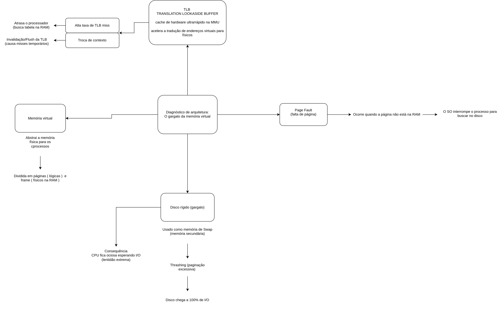

# diario_bordo_sist_op4
José Flávio Xavier 253576472
Gabriel Castro 25203195-2

Parte A: O Fenômeno da Paginação e o Gargalo do Disco

A)O que é um page fault?
De maneira grosseira, a falha de página ou page fault é quando uma aplicação tenta acessar dados, estando eles na memória principal ou na memória ram, mas eles não estão lá.

B)E o execesso de Page Fault pode gerar?
As requisições começam a consumir muita mamória ram, faz com que o SO tente fazer o processo de swaping, que é a utilização da memória não volátíl, disco róigido, como memória ram/memória volátil. Quando o swaping ocorre com baixa frequência, o sistema perderá desempenho, porém quando isso ocorre com uma carga excessiva, ocorre o trashing. O trashing é um ciclo, pedido de mais memória, algorismo de substituição, liberação de ram, requisição de ram do processo antigo, ausência de ram e volta para o ínicio do ciclo.

Parte B: O Papel e a Eficiência da TLB
A)Translation Lookaside Buffer é um hardware ultrrápido que armazena os pares de tradução rápida, ou seja, um "GPS" com os endereços das páginas virtuais que a aplicação irá acessar na pagina física. Ela fica perto da MMU/CPU devido uma questão de arquitetura física, quando mais próximo, mais rápido será.

B)O TBL é a falha da sua execusão,por conseqûencia, a aplicação deve ir até a página real. Isso pode gerar dois cenários, o primeiro, A MMU/CPU, acesssa a página fisica, cria o "mapa" e depois passa para o TBL para uma próxima vez. Cenário B, o bit de verificação é "desligado" e ,por consequência, ocorre o swap/page fault.

Parte C: Síntese e Solução
A)Vamos dobrar?
Neste cenário, o serivdor dobra a sua memória ram,mas mantém o mesmo nível de acessos, as requsições de memória terão demandas para serem atendidas, reduzindo a criação de memória virtual/swap, o cpu poderá dedicar mais procesessamento para criação dos "MAPAS" para o TBL, o TBL miss irá diminuir e a o page fault irá reduzir, logo o servidor irá rodar de maneira mais fluida reduzindo os erros e aumentando a velocidade.
Uma excelente analogia seria tentar esvaziar uma caixa d'água com uma cano de 5mm de diametro e esvaziar a mesma caixa d'agua com um cano de 10mm. Ela erá esvaziar muito mais rápido.

REFERENCIAS

GEEKSFORGEEKS. Page Fault Handling. Disponível em: https://www.geeksforgeeks.org/computer-organization-architecture/page-fault-handling/. Acesso em: 22 out. 2026.

GEEKSFORGEEKS. Translation Lookaside Buffer (TLB). Disponível em: https://www.geeksforgeeks.org/computer-organization-architecture/translation-lookaside-buffer-tlb/. Acesso em: 22 out. 2026.

IDEIAS ESQUECIDAS. O thrashing nosso de cada dia. 7 out. 2026. Disponível em: https://ideiasesquecidas.com/2026/10/07/o-thrashing-nosso-de-cada-dia/. Acesso em: 22 out. 2026.

LENOVO. O que é page fault?. Disponível em: https://www.lenovo.com/br/pt/glossary/page-fault/. Acesso em: 22 out. 2026.

LENOVO. O que é thrashing?. Disponível em: https://www.lenovo.com/pt/pt/glossary/thrashing/. Acesso em: 22 out. 2026.

PROF. SANTIAGO - PROGRAMAÇÃO E CIÊNCIA. Me Salva Sistemas Operacionais: Arquitetura e Hardware da Paginação. [S. l.]: YouTube, 2023. 1 vídeo (7 min). Disponível em: https://www.youtube.com/watch?v=PphoGHUpaOc. Acesso em: 22 out. 2026.

UNIVESP. Sistemas Operacionais - Aula 19 - Paginação. [S. l.]: YouTube, 2017. 1 vídeo (21 min). Disponível em: https://www.youtube.com/watch?v=4EaBN98dk40. Acesso em: 22 out. 2026.
